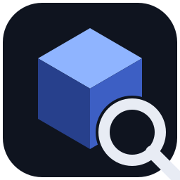

<a href="https://michaelmuckkremtz.github.io/glb-viewer/">
  <p align="center">
    
  </p>
</a>

## 🌐 Open now — no install, no login

- **3D Viewer** → https://michaelmuckkremtz.github.io/glb-viewer/
- **GLB Compressor** → https://michaelmuckkremtz.github.io/glb-viewer/compress.html

<sub>On a phone: open the viewer, tap **browse**, pick a `.glb` from Files. Share → *Add to Home Screen* makes it an app.</sub>

---

# GLB Web Toolkit

Two self-contained, zero-dependency web tools for 3D model files. No server,
no CDN, no install — open the HTML file directly (even via `file://`), or host
the folder anywhere (GitHub Pages, AirDrop, email). **Nothing is ever
uploaded anywhere; all processing happens in your browser.**

| File | What it does |
|---|---|
| `index.html` | **Generic GLB 3D viewer** — first-person + orbit, lighting presets, ASC CDL color grading, mobile touch controls |
| `compress.html` | **GLB compressor** — decimate + quantize + texture downscale any `.glb` entirely offline |

## Viewer (`index.html`)

- **Load a model**: drop a `.glb` file onto the page, click to browse, or open
  a share link `index.html#glb=<base64>` (deep links up to ~1.5 MB).
- **Move**: `WASD` walk, `Shift` run, `Space` jump, `Q`/`E` descend/ascend,
  `1` walk mode / `2` orbit mode, mouse or touch-drag to look,
  middle-drag / pinch for brightness.
- **Lighting**: 4 presets (Day / Dusk / Night / Studio) via the `L` menu.
- **Color grading** (`L` menu): ASC CDL lift/gamma/gain (sliders + 3 color
  wheels), saturation, `.cube` LUT import/export. The baked-in "standard"
  look is a soft, slightly lifted grade.
- **Capture**: `F` screenshot (PNG), `P` pose export (text, re-loadable).
- **Mobile**: on touch devices a virtual joystick, JUMP/Q/E/RUN buttons,
  drag-to-look and pinch-brightness appear automatically. Desktop UI is
  unchanged.
- Works best on room scans (PBR materials are normalized: metalness 0,
  roughness 1) but loads any glTF 2.0 binary.

## Compressor (`compress.html`)

Drop a `.glb`, pick a quality (45 % by default) and texture size (2048 px by
default), hit **Compress**, then **Save .glb** or **Open in viewer**.

Typical result for a 14 MB room scan: **~4.8 MB** (≈ 65 % reduction),
visually near-identical.

Pipeline (all local):
1. **Decimation** — meshoptimizer's `MeshoptSimplifier` (WASM, embedded).
2. **Quantization** — positions (and in-range UVs) as 16-bit, with scale +
   offset baked into node matrices. Primitives over 65 535 vertices keep
   32-bit data.
3. **Texture downscale** — via canvas, original format kept
   (JPEG stays JPEG, quality 0.85).

Notes:
- Output is fully standard glTF 2.0 GLB **except** the 16-bit normalized
  position buffers, which rely on the loader applying the node matrix (this
  repo's viewer does). For maximum third-party compatibility keep quality at
  100 % (disables quantization, still decimates + recompresses textures).
- Skinned meshes and nodes with children are automatically kept at full
  precision.

## GitHub Pages (optional)

```sh
git init && git add index.html compress.html README.md && git commit -m "glb toolkit"
# create empty repo on github.com, then:
git remote add origin https://github.com/<you>/glb-toolkit.git
git push -u origin main
# Settings → Pages → Deploy from branch → main / (root)
```

Then `https://<you>.github.io/glb-toolkit/` is your viewer. On the phone:
open the page → **browse** for a `.glb` in your Files/Downloads.

## Colophon — how this was built

The entire codebase in this repo (and the 19 MB roomscan viewer it was
derived from) was written by an AI coding agent, in one human-supervised
session, with zero lines hand-typed.

| | |
|---|---|
| **Agent harness** | `pi` coding agent v1.6.0 (terminal coding agent: file read / bash / edit / write tools, session-logged) |
| **Model** | **Qwen 3.8 27B** — `unsloth/Qwen3.8-27B-GGUF:UD-Q4_K_M` (≈4-bit GGUF quant), served **locally** by Splash on the author's Mac — no cloud API, $0.00 inference cost |
| **Reasoning** | medium thinking level — ≈ 211 k of the output tokens were internal reasoning |
| **Session size** | 475 model calls · **≈ 787 k tokens total** (376 k in / 411 k out) |
| **Wall time** | 6.5 h, human-in-the-loop (review, screenshots, approvals) with a 4K ProRes video encode running on the same machine |
| **Throughput** | ≈ 18 output tok/s end-to-end average (human waits + local test runs included); single requests ranged from < 1 s to 7 min (the outlier hit CPU contention) |
| **Verification** | Python 3.9 + Playwright headless Chromium (SwiftShader software GL) — 43 automated acceptance checks, all passing |

Everything the model produced was gated by the test suite before it was
considered done — including the compressor, which shipped broken four times
(corrupted typed-array copy, chunk padding, …) and was only accepted when a
round-trip render matched the original.

## Building (dev)

`glbviewer/` in the parent checkout contains `build_viewer.py` /
`build_compressor.py` which regenerate the HTML from the roomscan root viewer;
`tests/run_tests.py` is the Playwright milestone gate (`/usr/bin/python3
tests/run_tests.py all`).
